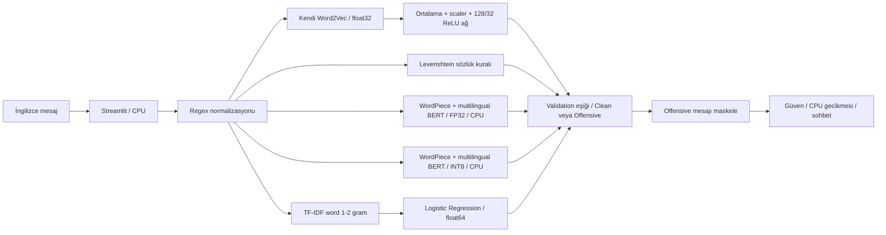

# ChatModel — SWE015 Real-Time Chat Moderation

## INT8 BERT sonuçları — 15 Kasım 2026

Uygulama varsayılan olarak ONNX Runtime üzerinde Multilingual BERT INT8
kullanır. Aşağıdaki Macro-F1 değerleri aynı 15.868 test mesajına aittir.
Apple M2 CPU gecikmesi her satırda 300 tek mesaj tahminiyle ölçüldü.

| Model | Macro-F1 | Ortalama ms | p95 ms | Boyut MB |
| --- | ---: | ---: | ---: | ---: |
| TF-IDF + Logistic Regression | 0,8866 | 0,57 | 1,12 | 2,42 |
| Word2Vec + Neural Network | 0,8678 | 0,32 | 0,74 | 20,99 |
| Multilingual BERT FP32 | 0,8448 | 45,01 | 62,25 | 715,36 |
| Multilingual BERT INT8 | 0,8453 | 14,51 | 23,34 | 182,95 |
| Edit-distance sözlük kuralı | 0,7878 | 0,12 | 0,41 | 0,0005 |

INT8, 50 ms p95 hedefini karşıladı. FP32 ve INT8 gecikmeleri sırasıyla
PyTorch (tek iş parçacığı) ve ONNX Runtime (dört iş parçacığı) ile ölçüldü.
Fark, quantization ile birlikte çalışma ortamı ve iş parçacığı ayarının
etkisini içerir. FP32 toplu test skoru MPS'de, INT8 skoru CPU'da hesaplandı.
Ayrıntılar `reports/comparison.json` dosyasında.

Modeli yeniden üretmek için `python -m scripts.quantize_bert` çalıştırın.
Kurulum ve ölçüm adımları [INT8 model notlarında](chatmodel/models/quantized_bert/README.md).

## BERT aşaması — 15 Kasım 2026

Multilingual BERT gerçek Jigsaw verisiyle ince ayarlandı ve Streamlit model
seçicisine eklendi. 8 GB Apple M2 için eğitim kümesinden sınıf oranlarını koruyan
12.000 örnek kullanıldı. Son iki encoder katmanı, pooler ve sınıflandırma başlığı
2 epoch eğitildi; toplam 14.767.874 parametre güncellendi. İlk 10 katman ve
embeddingler donduruldu. İkinci epoch seçildi, tam validation kümesinde karar
eşiği 0,61 olarak belirlendi. Girdi sınırı 96 WordPiece token.

Ortak 15.868 test mesajında BERT Macro-F1 **0,8448** oldu. Bu ilk deneyde
TF-IDF (0,8866) ve Word2Vec + NN (0,8678) daha yüksek Macro-F1 verdi. Eğitim
örneği sayıları ve uzun mesajların kesilmesi de bu karşılaştırmanın sınırlarıdır.
Apple M2 CPU'da 300 çağrıda ortalama **45,012 ms**, p95 **62,253 ms**, model
boyutu **715,363 MB** ölçüldü. p95 için 50 ms hedefi sağlanmadı.

Toplu test skoru MPS üzerinde hesaplandı. CPU gecikmesi ve arayüz CPU'da
doğrulandı. İlk 32 test mesajında CPU/MPS kararları aynı çıktı; maksimum
olasılık farkı 0,00000088. Tüm test skorunu CPU'da tekrar üretmek için aşağıdaki
değerlendirme komutunda `--bert-device cpu` seçilebilir.

```bash
.venv/bin/python -m scripts.download_bert
.venv/bin/python -m scripts.train_bert --device mps
.venv/bin/python -m scripts.evaluate_models --bert-device mps
```

Mevcut eğitim tamamlandığı için uygulamayı açarken bu adımları tekrarlamak
gerekmez. Eğitilmiş dosyalar `artifacts/bert/`, eğitim günlüğü ve seçilen örnek
kimlikleri `reports/bert_training.json`, ortak sonuçlar `reports/comparison.json`
içindedir. Kesilen eğitimi aynı ayarlarla `--resume` ekleyerek devam ettirmek
mümkündür. Ayrıntılar `chatmodel/models/bert/README.md` dosyasında.

49 test geçti; gerçek BERT ile CPU tahmini, model seçimi, maskeleme ve ortak
test kimliği doğrulandı.

Uygulama İngilizce mesajları **Clean / Offensive** olarak sınıflandırır.
Jigsaw'ın gerçek eğitim verisi üzerinde TF-IDF + Logistic Regression ve
kendi Word2Vec vektörlerimizi kullanan bir feedforward sinir ağı eğitilir.
Ek olarak Levenshtein uzaklığı kullanan bir sözlük kuralı bulunur.
Streamlit sohbeti sınıf, güven skoru ve mesaj başına CPU gecikmesini gösterir;
Offensive mesajları tamamen maskeler. Mesajlar gönderildiğinde işlenir.

Yan panelden TF-IDF, eğitilmiş dosyası bulunan Neural Network ve sözlük kuralı
arasında geçiş yapılır. Her mesajın hangi yöntemle işlendiği geçmişte gösterilir.
Multilingual BERT gerçek veriyle ince ayarlandı ve INT8 sürümü uygulamanın
varsayılan modeli oldu. Teslim için sunum, video ve depo bağlantısı hazırlanır.

## İkinci aşama sonuçları — 14 Kasım 2026

Kendi Word2Vec modelimiz 126.941 eğitim mesajında 5 epoch eğitildi ve 54.697
sözcüklük sözlük oluşturdu. Sinir ağı 18 epoch çalıştı; validation Macro-F1
ölçümüne göre 13. epoch ve 0,86 karar eşiği seçildi. Testteki sonuçlar aşağıdadır.

| Yöntem | Test Macro-F1 | Ortalama CPU ms | p95 ms | Dosya MB |
| --- | ---: | ---: | ---: | ---: |
| TF-IDF + Logistic Regression | 0,8866 | 0,446 | 0,928 | 2,424 |
| Word2Vec + Neural Network | 0,8678 | 0,296 | 0,695 | 20,986 |
| Edit-distance sözlük kuralı | 0,7878 | 0,116 | 0,346 | 0,000503 |

Üçü aynı 15.868 örneklik testte, Apple M2 CPU'da ölçüldü. Gecikme 10 ısınma
sonrası 300 çağrının özetidir. Sözlük satırının boyutu yalnızca JSON dosyasıdır.
Bu deneyde TF-IDF en yüksek Macro-F1'ı verdi. Sinir ağı daha düşük gecikme ile
daha büyük dosya boyutu üretti. Sözlük kuralı 1.610 Offensive test mesajının
802'sini kaçırdı; bağlam ve sözlük kapsamı sınırları belirgindir.

Tam sonuçlar `reports/comparison.json`, eğitim günlüğü
`reports/neural_training.json` içindedir. 45 test geçti. Gerçek sinir ağı,
model değiştirme, karışık model geçmişi, maskeleme, geçersiz mesajlar ve BLAS
sayısal regresyonu test edildi. Sunucu sağlık kontrolü `ok` döndürdü.

## Doğrulanan ilk çalıştırma — 14 Kasım 2026

Apple M2 CPU / macOS 15.7.4 / Python 3.13.3 üzerinde gerçek veriyle ölçüldü:

| Ölçüm | Sonuç |
| --- | ---: |
| Ham Jigsaw örneği | 159.571 |
| Temizlik sonrası örnek | 158.677 |
| Eğitim / validation / test | 126.941 / 15.868 / 15.868 |
| Test Macro-F1 | 0,8866 |
| Test accuracy | %95,92 |
| Offensive precision / recall | %80,89 / %78,32 |
| Validation'da seçilen eşik | 0,63 |
| Ortalama / p95 CPU gecikmesi | 0,461 / 0,912 ms |
| Gecikme ölçümü | 300 çağrı, 10 ısınma |
| Sıkıştırılmış model dosyası | 2,424 MB |
| Model eğitimi | 23,42 saniye |

Tam sayılar ve veri hash'leri `reports/baseline_metrics.json` içindedir. Testte
349 Offensive mesaj kaçırıldı, 298 Clean mesaj yanlış işaretlendi; model kusursuz
değildir. 50 ms hedefi bu makinedeki sıcak baseline ölçümünde sağlandı; tarayıcı
gecikmesi veya gelecekteki BERT modelleri için aynı sonuç iddia edilmez.

`pytest`: **30 test geçti, skip yok**. Gerçek ağırlıklarla Streamlit AppTest
üzerinden mesaj gönderme, Offensive maskeleme ve sohbet temizleme doğrulandı.
Çalışan sunucunun `/_stcore/health` adresi `ok` döndürdü. Görsel tarayıcı
otomasyonu bağlantı kuramadığından ekranın görsel incelemesi tamamlanmadı.

## Kurulum ve çalıştırma

Python 3.13 ile doğrulanır. Proje dizininde:

```bash
python3.13 -m venv .venv
source .venv/bin/activate
python -m pip install -r requirements.txt
```

Bu Mac'teki ortam zaten `.venv` içindedir. Yeniden oluşturmak gerekmez.
Tam doğrulanan paket sürümleri `requirements-lock.txt` dosyasındadır. Hazır model
dosyalarını kullanmak için aynı Python sürümünde kilitli bağımlılıkları kurun.

### Eğitilmiş modellerle çalıştırma

[Google Drive model klasöründen](https://drive.google.com/drive/folders/1W2Kf67uLiYBwOc7L8obSmC98yNg5G0GH)
`chatmodel-int8.tar` ve `SHA256SUMS.txt` dosyalarını indirip proje kök dizinine
koyun. Varsayılan INT8 BERT ile başlamak için aşağıdaki adımlar yeterli.

```bash
.venv/bin/python -m pip install -r requirements-lock.txt
grep '  chatmodel-int8.tar$' SHA256SUMS.txt | shasum -a 256 -c - && tar -xf chatmodel-int8.tar
.venv/bin/python -m streamlit run app.py
```

Diğer üç eğitilmiş modeli de kullanmak için aynı klasörden
`chatmodel-extra-models.tar` dosyasını indirin. Proje kökünde
`grep '  chatmodel-extra-models.tar$' SHA256SUMS.txt | shasum -a 256 -c - && tar -xf chatmodel-extra-models.tar`
komutunu çalıştırın ve Streamlit sayfasını yenileyin.

### GitHub Releases üzerinden alternatif indirme

Varsayılan INT8 BERT arşivi [GitHub Releases](https://github.com/yarenbasoglu/ChatModel/releases/tag/v1.0.0)
sayfasında da 11 parça halinde bulunur. Proje kök dizininde aşağıdaki komutlarla
parçaları indirip birleştirebilirsiniz.

```bash
.venv/bin/python -m pip install -r requirements-lock.txt
mkdir -p artifacts/downloads
(
  set -e
  cd artifacts/downloads
  release_url=https://github.com/yarenbasoglu/ChatModel/releases/download/v1.0.0
  for suffix in aa ab ac ad ae af ag ah ai aj ak; do
    part="chatmodel-int8.tar.part-$suffix"
    curl -fLsS --retry 3 "$release_url/$part" -o "$part"
  done
  cat chatmodel-int8.tar.part-a[a-k] > chatmodel-int8.tar
  printf '%s  %s\n' '5638abff0d406c0b232e54b0c61b8a57efb2cf02a55c2b7386370b659917b541' 'chatmodel-int8.tar' |
    shasum -a 256 -c -
  tar -xf chatmodel-int8.tar -C ../..
)
.venv/bin/python -m streamlit run app.py
```

Bu adımlarla uygulamayı model eğitimine veya veri setine gerek kalmadan açabilirsiniz.
### Diğer hazır modelleri GitHub Releases üzerinden ekleme

TF-IDF, Word2Vec + sinir ağı ve FP32 BERT arşivi aynı sürümde 45 parçadır.
Proje kök dizininde bu adımları çalıştırıp Streamlit sayfasını yenileyin.

```bash
mkdir -p artifacts/downloads
(
  set -e
  cd artifacts/downloads
  release_url=https://github.com/yarenbasoglu/ChatModel/releases/download/v1.0.0
  for suffix in a{a..z} b{a..s}; do
    part="chatmodel-extra-models.tar.part-$suffix"
    curl -fLsS --retry 3 "$release_url/$part" -o "$part"
  done
  cat chatmodel-extra-models.tar.part-a[a-z] chatmodel-extra-models.tar.part-b[a-s] > chatmodel-extra-models.tar
  printf '%s  %s\n' '699494a4fad24d8c99d83b4de866a23c34471da8b0a5d660e5ecee8571699b6a' 'chatmodel-extra-models.tar' |
    shasum -a 256 -c -
  tar -xf chatmodel-extra-models.tar -C ../..
)
```

Veri ve modelleri yeniden üretmek için:

```bash
python -m scripts.download_data
python -m scripts.prepare_data
python -m scripts.train_baseline
```

Word2Vec + Neural Network eğitimi ve üç yöntemin ortak değerlendirmesi:

```bash
python -m pip install -r requirements-build.txt
python -m scripts.fix_gensim_blas
python -m scripts.train_neural
python -m scripts.evaluate_models
```

Bu Mac'te BLAS düzeltmesi uygulandı. Gensim 4.4.0, tam olarak -1.0 çıkan
bazı iç çarpımları hatalı yorumlayabiliyor. Düzeltme script'i kurulu paketin
Word2Vec Cython uzantısını iki `noexcept` bildirimiyle yeniden derler ve sayısal
regresyon kontrolünü çalıştırır. Kaynak kod ve lisans başlıkları paket kaynağından
korunur. Derleme C derleyicisi gerektirir; bu Mac'in mevcut clang derleyicisi
kullanıldı. Kontrol başarısız olursa önceki uzantı geri yüklenir. Script yeniden
çalıştırıldığında kontrol zaten geçiyorsa derlemeyi atlar. Eğitim komutu bu
kontrolü doğrular. Gensim tekrar kurulursa düzeltmeyi tekrar çalıştırın.
`requirements-lock.txt` paket sürümlerini sabitler; derlenmiş düzeltme ayrıca bu
komutla uygulanır. [Gensim hata kaydı](https://github.com/piskvorky/gensim/issues/3665).

Sinir ağını yeniden eğitmeden uygulamayı başlatmak için derleme gerekmez.
Model ağırlıkları `artifacts/neural.joblib`, epoch kayıtları
`reports/neural_training.json`, ortak test sonuçları `reports/comparison.json`
dosyalarındadır. Karşılaştırma komutu TF-IDF'i yeniden eğitmeden üç yöntemi aynı
15.868 test mesajında değerlendirir. `comparison.json` her çalıştırmada güncellenir.

Neural eğitiminde 100 boyutlu skip-gram Word2Vec yalnızca train'de 5 epoch
eğitilir. Mesaj vektörü bilinen kelime vektörlerinin ortalamasıdır. Train'de
öğrenilen StandardScaler ardından 128 ve 32 ReLU nöronlu iki gizli katman,
sigmoid çıkış, SGD ve backpropagation kullanılır. Sınıf dengesizliği train'den
hesaplanan örnek ağırlıklarıyla ele alınır. En fazla 30 epoch, 5 epoch sabırla
validation Macro-F1 üzerinden checkpoint ve karar eşiği seçilir. Test verisi
model/sözlük/ölçekleyici öğreniminde kullanılmaz. Yeni kelimeler ortalama dışında
kalır; mesajdaki tüm kelimeler bilinmiyorsa sıfır vektörü kullanılır.

Kural modeli elle hazırlanmış 22 sözcüklük İngilizce sözlük kullanır. Sözcük
sınırlarında tam eşleşme veya en az 5 harfli sözcüklerde Levenshtein uzaklığı
en fazla 1 ise Offensive kararı verir. Sözlük ve eşik testten önce sabitlendi.
Eşleşme skoru `1 - uzaklık / uzunluk` olarak gösterilir, eşleşme yoksa 0'dır.
Bu skor sözcük benzerliğini ifade eder; olasılık alanı boş bırakılır. Alıntılar
ve bağlam nedeniyle yanlış işaretlemeler, sözlük dışında kalan ifadelerde kaçırma
beklenir. Kural dosyası `chatmodel/models/rules_lexicon.json` içindedir.

Ortak benchmark aynı 300 mesajda ve tek BLAS iş parçacığıyla ölçülür. Sinir ağı
boyutu vektörleri, sözlüğü, scaler'ı ve ağ ağırlıklarını içerir. Sözlük kuralında
yalnızca JSON yapılandırmasının boyutu ölçülür. Ortak Python paketleri ve kod
boyuta dahil edilmez. İlk baseline raporunun orijinal ölçümleri aşağıda korunur.

Mevcut veri, split ve ağırlık dosyaları korunur; komutlar bunların üzerine
yazmaz. Yeni bir deney için `--output`, `--data-dir`, `--artifact` ve `--report`
seçenekleriyle ayrı konumlar kullanın. Eğitim komutu yeni yollarla farklı
artefakt üretirse arayüz varsayılan `artifacts/baseline.joblib` dosyasını kullanmaya
devam eder; alternatif model otomatik olarak etkinleşmez.

Tek çalıştırma komutu (ortamı etkinleştirmeden de çalışır):

```bash
.venv/bin/python -m streamlit run app.py
```

Tarayıcıda http://localhost:8501 açılır. Durdurmak için terminalde Ctrl+C.
Uygulama yalnızca bu bilgisayarda dinler; dışarıya yayınlanmaz.

## Veri ve deney yöntemi

- Asıl kaynak: [Jigsaw Toxic Comment Classification / Kaggle](https://www.kaggle.com/c/jigsaw-toxic-comment-classification-challenge/data).
- Otomatik indirme: [tasksource/jigsaw_toxicity açık topluluk kopyası](https://huggingface.co/datasets/tasksource/jigsaw_toxicity), revision `d72c9a21492fe5db98cebb029f4fb0ec20e78e30`.
- İndirme 159.571 satır, sütunlar, benzersiz kimlikler ve ikili etiketler açısından doğrulanır. Kaynak, tarih ve SHA-256 `data/raw/train.source.json` dosyasına yazılır. Bu dosya Kaggle'dan oturum açılarak indirilmiş bir kopya değildir.
- Herhangi bir `toxic`, `severe_toxic`, `obscene`, `threat`, `insult`, `identity_hate` etiketi 1 ise **Offensive**, aksi hâlde **Clean**.
- NFKC/casefold, URL/e-posta temizliği, Türkçe karakter normalizasyonu, sözcük içindeki sınırlı leetspeak dönüşümü ve 3+ tekrarın iki harfe indirilmesi uygulanır. Aynı fonksiyon eğitimde ve tahminde kullanılır. Bu dönüşümler tüm gizlenmiş küfürleri çözmez.
- Boş metinler elenir. Normalizasyon sonrası aynı metinler tekilleştirilir; çelişkili etiketli aynı metinlerin tüm satırları çıkarılır. Böylece birebir normalize kopyalar split'ler arasında sızmaz; yakın-anlamlı kopya tespiti yapılmaz.
- `random_state=42` ile sınıf oranlarını koruyan yaklaşık %80/%10/%10 train/validation/test ayrımı oluşturulur. Bu, orijinal Kaggle train içinden ayrılmış dahili testtir; Kaggle yarışma test skoru değildir.
- TF-IDF yalnızca train üzerinde öğrenilir: 1–2 sözcük n-gram, en çok 120.000 özellik, min_df=2, sublinear TF. Logistic Regression: C=4, balanced class weights, liblinear, max_iter=1000.
- Karar eşiği yalnızca validation Macro-F1 üzerinden 0.10–0.90 aralığında seçilir. Test, sonuç raporlamak için kullanılır. İlerideki modeller aynı kaydedilmiş test kümesini kullanmalıdır.
- Model dosyası sıkıştırılmış joblib boyutudur (MB=1.000.000 byte); RAM ölçümü değildir. Güven seçilen sınıfın olasılığıdır, ayrıca kalibre edilmedi. Validation ile seçilen eşik 0.5 olmayabileceğinden seçilen sınıf güveni %50'nin altında olabilir.
- Gecikme 10 ısınma sonrası 300 tek-mesaj CPU çağrısıyla ölçülür; regex, vectorization ve classifier dahildir, soğuk yükleme ve ekran çizimi hariçtir. Rapor donanımı, ortalama/medyan/p95/maksimumu içerir. Arayüz 5.000 karakter ile sınırlıdır; benchmark bu sınırdaki test mesajlarından örnekler, F1 tüm test kümesinde ölçülür.

İndirme engellenirse script açık hata verir ve sahte veri oluşturmaz. Kaggle'dan
`train.csv.zip` indirip içindeki `train.csv` dosyasını `data/raw/train.csv` olarak
yerleştirin; sonra hazırlama/eğitim komutlarını çalıştırın. Kaynak şartları için
[Google veri kartını](https://huggingface.co/datasets/google/jigsaw_toxicity_pred)
ve Kaggle sayfasını inceleyin: Google kartı etiketleri CC0, Wikipedia metnini
CC-BY-SA 3.0 olarak tarif eder; topluluk kopyasının Apache-2.0 etiketiyle bu
farklılığı göz ardı etmeyin. Ham veri ve ağırlıklar Git'e eklenmez.

## Testler

```bash
.venv/bin/python -m pytest -q
```

Testler regex, etiket doğrulama, yinelenen metin/split sızıntısı, checksum,
model kaydetme/yükleme, geçersiz girdi, eşik seçimi ve Streamlit sohbet/maskeyi
kontrol eder. Gerçek model yoksa gerçek-model arayüz testi açıkça skip edilir;
birim testlerin küçük yapay verileri akademik skor üretmez.

## Proje yapısı

```text
app.py                       Streamlit sohbeti
chatmodel/preprocessing.py    Ortak regex ön işleme
chatmodel/data.py             Şema, tekilleştirme, sabit splitler
chatmodel/evaluation.py       Macro-F1 ve CPU benchmark
chatmodel/models/base.py      Ortak tahmin arayüzü
chatmodel/models/baseline.py  Eğitilen TF-IDF + LR
chatmodel/models/neural/      Word2Vec ortalamaları + eğitilmiş feedforward ağ
chatmodel/models/rules.py     Levenshtein sözlük kuralı
chatmodel/models/bert/        CPU'da çalışan fine-tuned multilingual BERT
chatmodel/models/quantized_bert/  ONNX Runtime ile INT8 CPU tahmini
scripts/                     İndirme, hazırlama ve eğitim komutları
data/raw/                    Gerçek ham veri ve kaynak kaydı (Git dışında)
data/processed/              Sabit splitler ve hash manifesti (Git dışında)
artifacts/                   Gerçek eğitimden çıkan model (Git dışında)
reports/                     Ölçülen sonuçlar
tests/                       Birim ve arayüz testleri
```

## Mimari ve kalan işler



Her model için aynı testte Macro-F1, boyut ve ≥100 çağrılık gecikme raporlanmalı.
50 ms hedefi ilk deney hedefidir; sonraki modeller için peşinen sağlandı denmez.

Bu İngilizce Wikipedia veri kümesi oyun sohbetini birebir temsil etmez; bağlam,
alay, alıntı, lehçe ve Türkçe girdiler hata üretebilir. Regex'in Türkçe harfleri
işlemesi Türkçe model eğitildiği anlamına gelmez. Sonuçlar otomatik ceza vermek
için tek başına kullanılmamalıdır. joblib yalnızca bu projede üretilmiş güvenilir
dosyalardan yüklenmelidir. Sohbet ve gecikme geçmişi oturum boyunca bellekte
tutulur. Sohbet temizlendiğinde geçmiş silinir. Saldırgan mesajlar geçmişte
maskeli olarak gösterilir.

AI kullanım kaydı: Bu başlangıç sürümünün kodu, testleri ve dokümantasyonu
OpenAI Codex yardımıyla oluşturuldu. Öğrenci kodu incelemeli, deneyleri
tekrarlamalı ve final sunumunda AI Usage slaytına kullanılan yardımı yazmalıdır.
